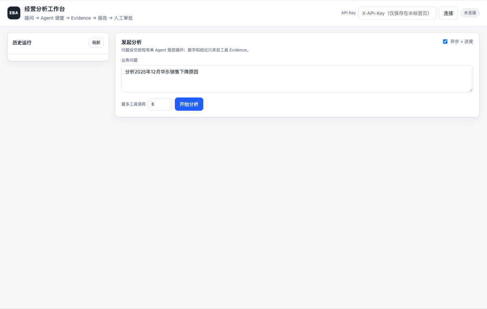
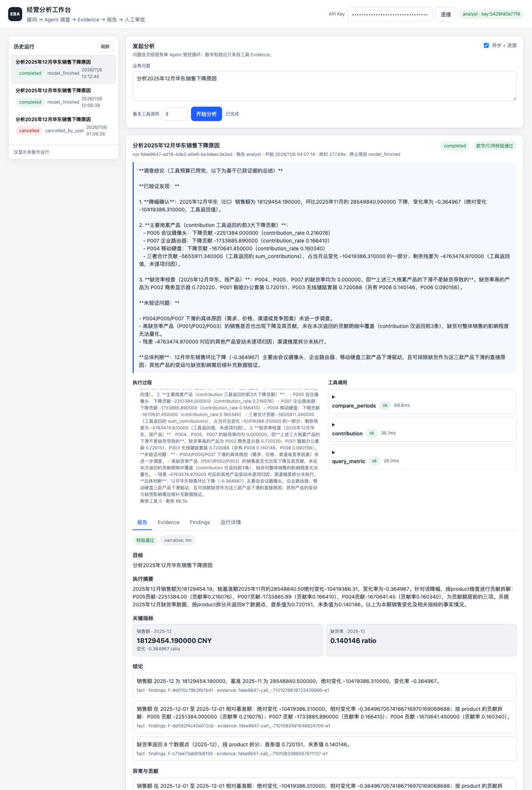
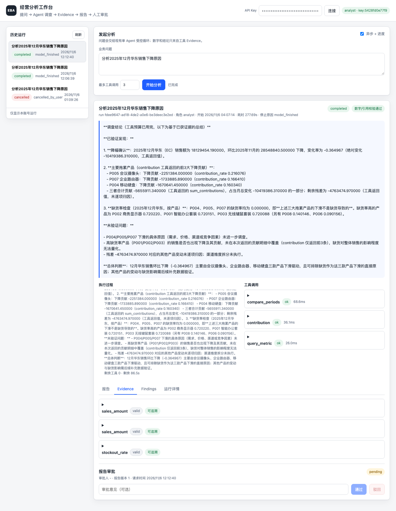
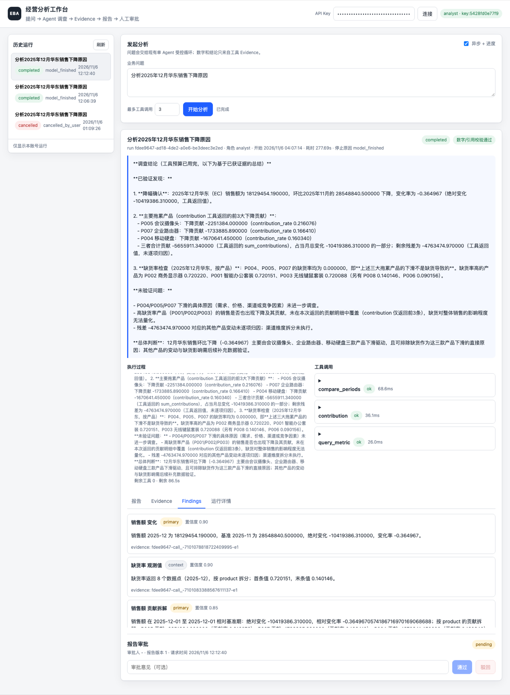

[](https://github.com/Lipeixi-create/enterprise-business-agent/actions/workflows/ci.yml)
# Enterprise Business Agent

**企业多部门经营分析 Agent**：把一句中文经营问题（如“为什么本季度利润下降？”）变成一次受控的自主调查——Agent 自己决定下一步查什么、调用哪个工具，最终输出**每个数字都能追溯到证据**的归因结论与结构化报告。

> 核心不是“让 LLM 写 SQL”，而是用**语义层 + 确定性计算 + 证据链**把 LLM 的自主性约束在可信边界内。

`Python 3.11+` · `FastAPI` · `LangGraph` · `PostgreSQL 16` · `SQLAlchemy 2` · `Pydantic v2` · `SQLGlot` · `OpenTelemetry`

---

## 为什么这个项目值得看

| 设计选择 | 解决的问题 |
| --- | --- |
| **Semantic-first**：34 个指标口径 + 7 个维度注册表 | “利润”“毛利率”口径不一，Text-to-SQL 极易算错；指标可测试、可版本化 |
| **Evidence-first**：Evidence Ledger → Finding → Report → Numeric Validator | LLM 编造数字；报告中每个业务数字必须指向 `evidence_id` 的原始值 |
| **Single Agent + 工具注册表**：`decide → act → decide` 条件边 | 五个业务域是工具维度，不是 Agent 维度；避免多 Agent 的路由与上下文同步成本 |
| **Bounded autonomy**：工具次数/时间/Token 三重预算 + 语义去重 | Agent 过度调查、重复查询、无限循环 |
| **Least privilege**：只读账号 + AST SQL Guard + 应用层授权 | 模型永远拿不到数据库连接，也不能生成/执行 SQL |
| **可恢复运行时**：PostgreSQL 持久化 + Checkpoint + Lease/Fencing | 进程重启、并发抢占、重复执行、审批状态丢失 |

---

## 界面预览

<p align="center">
  
</p>

<p align="center">
  
</p>

<p align="center">
  
</p>

<p align="center">
  
</p>

> 截图来自真实浏览器 E2E（Docker Compose + PostgreSQL 后端），不是设计稿。

---

## 系统架构

```mermaid
flowchart TB
    subgraph Client["客户端"]
        WB["业务工作台 /workbench/"]
        API_CLIENT["HTTP / SSE 调用方"]
    end

    subgraph API["API 层 · FastAPI"]
        AUTH["X-API-Key 认证 / 角色 Scope"]
        RUNS["Run 生命周期 / SSE / 取消 / 审批"]
        MW["请求 ID · 结构化日志 · 异常映射"]
    end

    subgraph Agent["Agent Runtime · LangGraph"]
        DECIDE["decide：选择下一步工具"]
        ACT["act：执行工具 + 回填结果"]
        BUDGET["预算 / 去重 / 超时 / 熔断"]
        DECIDE --> ACT --> DECIDE
        BUDGET -.约束.-> DECIDE
    end

    subgraph Capability["能力层"]
        RESOLVER["Metric Resolver<br/>中文别名 / 歧义检测"]
        COMPILER["Query Compiler<br/>白名单 + 绑定参数"]
        ENGINE["Analysis Engine<br/>MoM / YoY / TopN / 贡献 / 趋势 / 异常"]
        EVIDENCE["Evidence Ledger<br/>Finding / 归因 / 报告 / 数字校验"]
    end

    subgraph Security["安全层"]
        GUARD["Semantic Guard<br/>结构化查询契约"]
        SQLGUARD["SQLGlot AST Guard"]
        EXEC["只读执行器<br/>超时 / 行数 / OFFSET"]
    end

    subgraph Data["数据层"]
        PG[("PostgreSQL 16<br/>业务表 + agent_* 运行时表")]
        SL["语义层<br/>metrics.json · dimensions.json"]
    end

    subgraph Obs["可观测性"]
        OTEL["OpenTelemetry<br/>file / OTLP / console"]
        ALERT["运行指标 / 告警"]
    end

    WB --> AUTH --> RUNS --> DECIDE
    API_CLIENT --> AUTH
    ACT --> RESOLVER --> COMPILER --> GUARD --> EXEC --> PG
    ACT --> ENGINE --> EVIDENCE
    SL --> RESOLVER
    EVIDENCE --> PG
    RUNS --> PG
    Agent --> OTEL
    API --> OTEL
```



**一次分析的生命周期**

```
提问 → 指标解析 → 选择工具 → 编译查询 → 只读执行 → 生成 Evidence
   ↑                                                    ↓
   └──────────── 观察结果 / 更新预算 ←──────────────────┘
                          ↓
         Finding → 归因 → 结构化报告 → 数字校验 → 人工审批
```

---

## 技术栈

| 层 | 技术 | 用途 |
| --- | --- | --- |
| 语言 / 包管理 | Python 3.11+，setuptools | 数据与 LLM 生态；`pyproject.toml` |
| API | FastAPI + Uvicorn | 异步端点、SSE、Pydantic 校验 |
| Agent 编排 | LangGraph | 显式状态图、条件边、Checkpoint、中断恢复 |
| 数据访问 | SQLAlchemy 2 + Alembic + psycopg 3 | ORM、迁移、PostgreSQL 运行时 |
| 数据校验 | Pydantic v2 | 工具契约、API 契约、结构化输出 |
| SQL 安全 | SQLGlot | AST 级校验、表/列/函数白名单 |
| 数据库 | PostgreSQL 16 / SQLite（本地） | 窗口函数、CTE、JSONB；SQLite 只读开发链路 |
| LLM | 智谱 GLM（OpenAI 兼容）+ Anthropic 适配器 | Function Calling、provider 可切换 |
| 可观测性 | OpenTelemetry SDK + OTLP/HTTP + 自建 Collector | 全链路 span、JSONL 本地导出 |
| 前端 | 原生 HTML/CSS/JS | 零构建工作台，`sessionStorage` 保存 Key |
| 部署 | Docker + Docker Compose | PostgreSQL + init + app 三段式编排 |
| 测试 | pytest | 765 个离线测试，58 个测试文件 |

---

## 核心算法与机制

| 机制 | 实现要点 |
| --- | --- |
| **指标解析** | canonical 名称 → label → 同义词三级匹配；`利润` 命中歧义时返回候选而非静默选择 |
| **查询编译** | 只接受结构化请求；表/列/维度/函数全部来自注册表白名单；值全部绑定参数；比率指标先汇总分子/分母再相除 |
| **加性语义** | 加性指标求和；半加性（库存/人数）取期末值；比率指标不做比率的简单平均 |
| **贡献归因** | `contribution_rate = Δ维度 / Δ总量`，仅对加性指标开放；返回方向、残差、`not_applicable` |
| **趋势判定** | 首尾变化率 ±5% + 主导步方向 → growth/decline；符号反转 ≥2 次或变异系数 >0.25 → volatile |
| **异常检测** | `mom_threshold`（环比阈值）与滚动 `z-score`；返回触发规则、阈值、基线，而非只给“异常”标签 |
| **语义去重** | 以「指标 + 时间范围 + 过滤 + 维度 + 粒度/排序」判断已有结果是否覆盖新调用；命中则复用证据、不消耗工具预算 |
| **数字校验** | 报告中每个数字必须匹配 Evidence 原值，或由两个原值做一次四则运算得到；允许百分比/舍入等价，拒绝模糊近似 |
| **预算调度** | 工具次数、单 Run 墙钟、Token 三重上限；剩余时间不足以完成一次模型调用时提前停止并保留已完成证据 |
| **调用可靠性** | 连接/读取/总超时分离；401/403 不重试，429/5xx/超时指数退避（`base × 2^attempt`，上限 8s）；连续失败熔断 + 半开探测 |
| **并发控制** | 数据库条件 UPDATE 抢占 + 租约续期 + `claim_version` fencing；租约被接管后旧 Worker 不能写入 |

完整公式、状态机与调用序列见 [docs/PROJECT_DEVELOPMENT.md](docs/PROJECT_DEVELOPMENT.md)。

---

## 快速开始

```bash
# 一键本地演示：SQLite 业务库 + SQLite 运行库，不依赖 PostgreSQL / Docker
bash scripts/run_local_demo.sh          # 默认 8000 端口
# 打开 http://127.0.0.1:8000/workbench/
```

工作台支持：API Key 连接、同步/异步提问、SSE 进度、取消、运行历史、报告、Evidence、Findings、审批。

手动运行：

```bash
python -m venv .venv && source .venv/bin/activate
pip install -r requirements.txt
export PYTHONPATH=src

python scripts/init_db.py --database-url sqlite:///./enterprise_business_agent.db
python scripts/generate_data.py --database-url sqlite:///./enterprise_business_agent.db --reset
python scripts/quality_check.py --database-url sqlite:///./enterprise_business_agent.db

# 确定性分析 CLI（不需要 LLM）
python scripts/analyze.py demo --name all
python scripts/analyze.py compare --metric 净利润 --kind qoq --year 2025 --quarter 4

# FastAPI
uvicorn enterprise_business_agent.api.app:app --host 127.0.0.1 --port 8000
```

配置真实模型（可选）：

```bash
cp .env.example .env
# 填入 LLM_PROVIDER / LLM_MODEL / LLM_BASE_URL / GLM_API_KEY
# 未配置 Key 时 Agent 返回 llm_unavailable，不会伪造成功
```

Docker Compose：

```bash
cp .env.docker.example .env.docker   # 替换全部 change-me 值
docker compose --env-file .env.docker up --build
```

---

本地开发与测试：

```bash
pip install -r requirements.lock   # 可复现依赖（由 requirements.txt 编译，Python 3.11）
pytest -q                          # 离线套件；未配置 PostgreSQL 时 30 个 PG 专项 skip
```

CI 使用同一份 lockfile 在 Python 3.11 上运行离线套件，见 [`.github/workflows/ci.yml`](.github/workflows/ci.yml)。

---

## API 概览

| 方法与路径 | 说明 |
| --- | --- |
| `GET /health` | 数据库、只读状态、LLM、鉴权、版本 |
| `POST /api/v1/analysis/natural-language` | 自然语言分析（语义优先，LLM 可选） |
| `POST /api/v1/metrics/query` | 结构化指标查询（不接受原始 SQL） |
| `POST /api/v1/agent/runs` / `.../async` | 同步 / 异步 Agent 调查 |
| `GET /api/v1/agent/runs/{id}/stream` | SSE 进度流 |
| `POST /api/v1/agent/runs/{id}/cancel` | 协作式取消 |
| `GET .../evidence` `.../findings` `.../report` | 证据链、发现、结构化报告 |
| `GET .../report/validation` | 数字/单位/口径校验结果 |
| `POST .../report/approval/decision` | 人工审批（版本 + 指纹绑定） |
| `GET /api/v1/agent/approvals` | 跨 Run 审批列表 |
| `GET /api/v1/metrics` / `GET /api/v1/alerts` | 运行质量指标 / 告警（admin） |
| `POST /mcp` | 可选 MCP JSON-RPC 工具传输（复用同一套权限与安全链） |

---

## 项目结构

```text
src/enterprise_business_agent/
├── agent/            # LangGraph decide/act、工具注册表、Checkpoint、语义去重
├── analysis/         # MoM/QoQ/YoY、TopN、贡献、趋势、异常（纯确定性）
├── api/              # FastAPI 应用、路由、鉴权、Run 管理、运行时存储
├── evidence/         # Evidence Ledger、Finding、归因、报告、Numeric Validator
├── llm/              # provider 适配、超时传输层、重试/熔断、结构化输出
├── nl/               # 自然语言契约、规则/LLM 规划器、受限 SQL 兜底
├── security/         # SQL Guard、只读执行器、语义查询守卫、审计
├── observability/    # OTel span、导出器、告警
├── mcp/              # MCP 服务端传输
└── web/              # 工作台（原生 HTML/CSS/JS）

semantic_layer/       # 34 个指标 + 7 个维度注册表
alembic/              # 数据库迁移
scripts/              # 初始化、数据生成、评测、浏览器 E2E、trace 查看
tests/                # 58 个测试文件（单元 / 集成 / 安全 / 评测）
docs/                 # 开发文档 + 设计文档；阶段性报告归档在 docs/archive/
```

---

### 10 分钟代码导览

如果只看几个文件，建议按这个顺序：

| 文件 | 看什么 |
| --- | --- |
| [`agent/graph.py`](src/enterprise_business_agent/agent/graph.py) | `decide → act → decide`、三重预算、语义去重、数字纠错、终止状态 |
| [`agent/tools.py`](src/enterprise_business_agent/agent/tools.py) | 8 个只读工具的 Pydantic 契约、scope 授权、超时与重试 |
| [`query_compiler.py`](src/enterprise_business_agent/query_compiler.py) | 指标定义 → 白名单标识符 + 绑定参数的 SQL |
| [`security/sql_guard.py`](src/enterprise_business_agent/security/sql_guard.py) | SQLGlot AST 校验：单语句、表白名单、禁止 DDL/DML |
| [`evidence/validator.py`](src/enterprise_business_agent/evidence/validator.py) | Numeric Validator：引用、单位、口径、派生数字 |
| [`api/run_store.py`](src/enterprise_business_agent/api/run_store.py) | 条件 UPDATE 抢占、租约续期、`claim_version` fencing、幂等 |

---

## 验证与评测

| 项目 | 结果 |
| --- | --- |
| 离线回归 | **765 passed, 30 skipped**（30 个 skip 为未配置 PostgreSQL 的专项） |
| 真实模型全量评测 | 92 条语料，90 条计分，真实调用 210 次，as-run **69/90**；离线后验 **76/90** |
| 多种子稳定性 | 24 条 × seeds 42/7/123，通过率 **54.55% / 63.64% / 72.73%** |
| 真实 PostgreSQL | 最小权限、持久化、Checkpoint 恢复、并发抢占、Lease/Fencing、幂等、隔离：**30 passed / 0 failed** |
| Docker / Compose | 真实镜像构建、PG16 + init/迁移/种子（23 张表）、健康检查通过 |
| 外部 OTLP | 自建 `otelcol-contrib` 接收 **257 个 span**，覆盖完整工作流 |
| 浏览器 E2E | 主机与容器后端各一轮 `ok=true`（提问→调查→报告→Evidence→审批→历史→取消恢复） |

> 评测原则：真实模型结果、脚本化假客户端结果、未执行项**严格分栏记录**；不修改 Ground Truth、评分阈值或安全规则来提高通过率。

---

## 已知边界（如实记录）

- 最终部署镜像由「已构建镜像 + `COPY src`」派生层生成，canonical 全量重建曾被 PyPI 读超时阻塞；
- 容器到 provider 的网络存在波动（同容器出现过 32 分钟停顿与 73 秒完成），**不能据此宣称稳定**；
- 托管 PostgreSQL、多节点、TLS、备份/PITR、容量压测未验证；
- 托管 OTLP 后端、采样、长期存储未验证；Collector 运行在宿主机而非 Compose 内；
- 授权是角色级指标/维度/区域限制，不是完整 RBAC/RLS；
- 工具超时依赖线程 Future，没有进程级资源隔离；
- 密钥轮换为用户声明，未做控制台级技术验证。

---

## 文档

- **[项目开发文档（技术栈 / 算法 / 架构图）](docs/PROJECT_DEVELOPMENT.md)** ← 面试主文档
- **[Agent 岗位高频面试题（含参考答案与追问）](docs/INTERVIEW_QUESTIONS.md)** ← 面试准备
- [总体架构设计](docs/01-architecture.md)
- [数据模型与指标语义层](docs/02-data-and-metrics.md)
- [Agent Runtime、工具与 Evidence Chain](docs/03-agent-runtime.md)
- [安全与治理](docs/04-security-and-governance.md)
- [评测与可观测性](docs/06-evaluation-and-observability.md)
- [部署与只读检查](docs/PRODUCTION_DEPLOYMENT.md)
- [安全策略](SECURITY.md)
- [阶段性验收报告归档](docs/archive/)

---

MIT License © 2026 Enterprise Business Agent contributors
