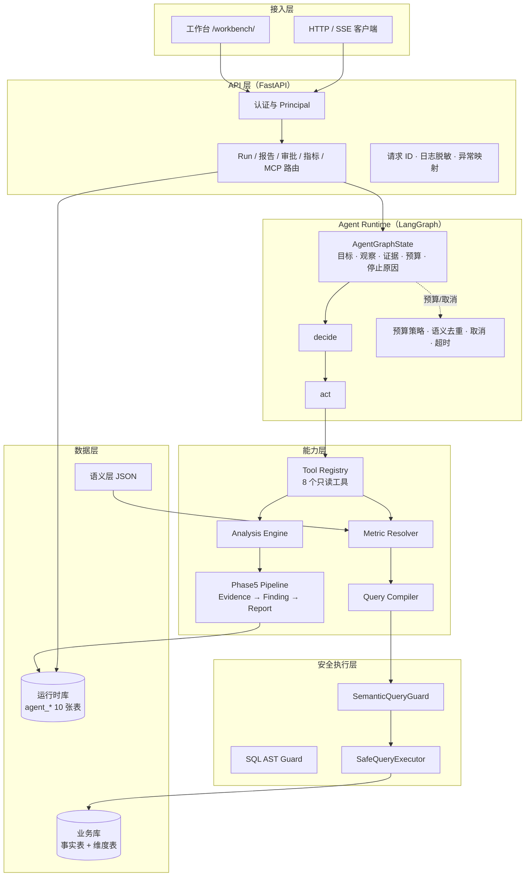
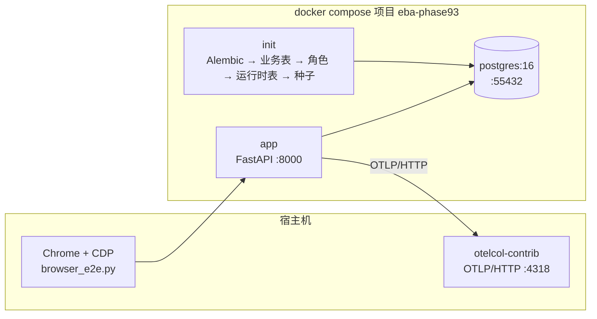
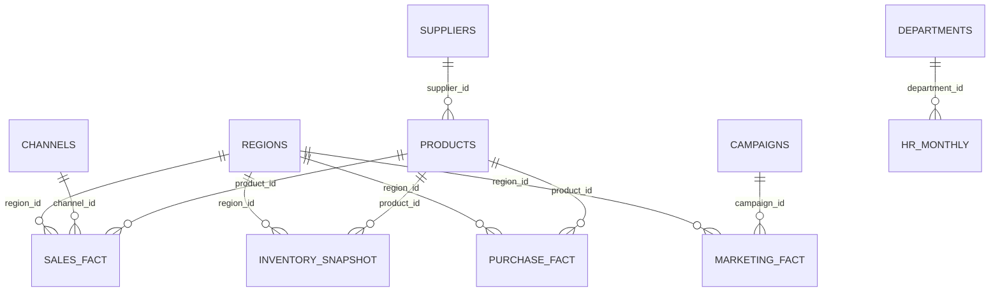
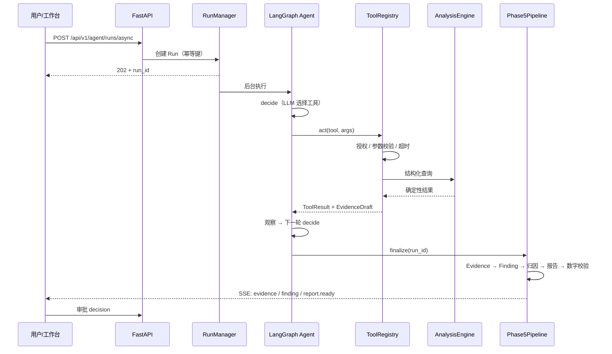
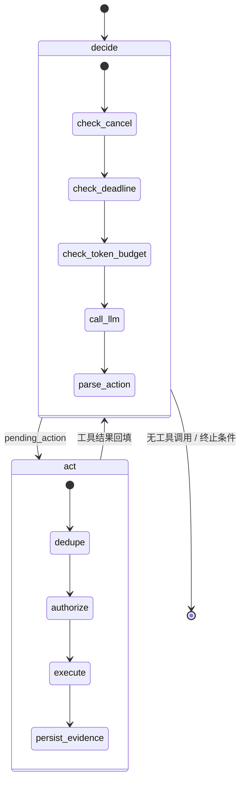

# 项目开发文档 — Enterprise Business Agent

> 面向面试与工程复盘的项目说明：技术栈、系统架构、核心算法、安全边界、可靠性设计与评测方法。
>
> 代码基线：`0.6.0`；文档日期：2026-11-10。

---

## 1. 项目定位

### 1.1 一句话

一个**可信的企业经营分析 Agent**：用户用中文提出经营问题，Agent 自主决定调查路径、跨五个业务域调用只读工具，最终输出带证据链、可校验数字和结构化报告的归因结论。

### 1.2 它解决的不是“生成 SQL”

Text-to-SQL 的三个致命问题：

1. **口径不一致**——“利润”可能是毛利或净利，“ROI”分子分母定义不同；
2. **数字不可信**——LLM 会编造、四舍五入、跨行汇总；
3. **权限不可控**——让模型直接持有数据库凭据是安全事故。

本项目的答案是：**语义层负责口径，确定性引擎负责数字，证据账本负责追溯，Guard + 只读账号负责权限，LLM 只负责“下一步做什么”。**

### 1.3 设计原则

| 原则 | 落地 |
| --- | --- |
| Semantic-first | 指标注册表 + Metric Resolver + Query Compiler |
| Deterministic numbers | 数字来自 SQL 聚合或 Python `Decimal` 计算 |
| Evidence-first | 每次工具调用生成 Evidence，报告数字引用 `ValueReference` |
| Tool-first | Agent 只能通过 Tool Registry 访问能力 |
| Least privilege | 模型无数据库连接；只读账号 + AST Guard |
| Single agent | 一个 LangGraph 状态图，业务域是工具维度 |
| Bounded autonomy | 工具数 / 时间 / Token 三重预算 + 去重 + 停止原因 |
| Progressive delivery | 每阶段可独立验收，真实结果与脚本化结果分栏记录 |

---

## 2. 技术栈

### 2.1 选型总表

| 领域 | 选择 | 版本约束 | 选型理由 |
| --- | --- | --- | --- |
| 语言 | Python | ≥3.11 | 数据/LLM 生态成熟 |
| API | FastAPI + Uvicorn | `fastapi>=0.115` | Pydantic 原生、异步、SSE 方便 |
| Agent 编排 | LangGraph | `>=1.2,<2.0` | 显式状态图、条件边、Checkpoint、可恢复 |
| ORM / 迁移 | SQLAlchemy 2 + Alembic | `>=2.0` / `>=1.13` | 迁移可控，SQLite/PG 双支持 |
| 驱动 | psycopg 3 | `>=3.2` | PostgreSQL 原生异步/同步支持 |
| 契约 | Pydantic v2 | `>=2.7` | 工具参数、API、LLM 结构化输出 |
| SQL 解析 | SQLGlot | `>=27,<28` | AST 级校验、方言支持 |
| 数据库 | PostgreSQL 16 / SQLite | — | 窗口函数、CTE、JSONB；SQLite 用于零依赖演示 |
| LLM | 智谱 GLM（OpenAI 兼容）+ Anthropic 适配器 | — | Provider Factory 可切换，避免锁定 |
| 可观测性 | OpenTelemetry SDK + OTLP/HTTP | 可选 `.[otel]` | 不安装时业务行为不变 |
| 前端 | 原生 HTML/CSS/JS | — | 零构建、同源、无额外依赖 |
| 部署 | Docker + Docker Compose | — | 单机规模不需要 K8s |
| 测试 | pytest | — | 765 个离线测试 |

### 2.2 为什么是这套组合

- **FastAPI**：Agent 是长任务，需要异步 Run + SSE；Pydantic 契约同时用于 API 和工具参数。
- **LangGraph**：需要“显式状态 + 条件边 + checkpoint 恢复”，而不是黑盒 Agent executor。
- **SQLGlot**：`sqlparse` 只能分词，无法做 AST 级表白名单和函数校验。
- **PostgreSQL**：运行时表需要并发抢占、条件 UPDATE、租约和事务化清理。
- **原生前端**：面试项目重点在后端可信链路，工作台只需证明端到端可用。

---

## 3. 系统架构

### 3.1 分层架构



### 3.2 关键边界

| 边界 | 规则 |
| --- | --- |
| API 层 | 只做鉴权、Run 生命周期、事件推送、结果读取；不含业务推理 |
| Agent 层 | 不直接 `import` 数据库 Session；只能调用 Tool Registry |
| 工具层 | 不接收 SQL 文本；只接收结构化参数，经语义守卫后执行 |
| 证据层 | 报告生成器不能自己算数；数字只能引用 Evidence 原值 |
| 执行层 | Guard 是执行前的最后一道关，不是 Prompt 里的“请不要写 DELETE” |

### 3.3 部署形态



- `init` 顺序：Alembic 迁移 → 业务表 → `eba_readonly` 角色 → 运行时 schema → Phase 5 证据表 → 种子数据。
- `app` 使用 `eba_readonly`（业务只读）与 `eba_runtime`（仅 `agent_*` 表 DML）两个最小权限角色。
- 运行时表缺失或 PostgreSQL 不可达时直接报错，**不回退 SQLite**。

---

## 4. 模块设计

| 模块 | 代码位置 | 职责 |
| --- | --- | --- |
| 配置 | `config.py` | 环境变量、密钥字段 `repr=False / exclude=True` |
| 数据模型 | `models.py`、`sql/schema.sql`、`alembic/` | 五域事实表/维度表 |
| 语义层 | `semantic.py`、`metric_resolver.py`、`query_compiler.py` | 指标注册、别名解析、参数化 SQL |
| 分析引擎 | `analysis/engine.py` | 聚合、对比、TopN、贡献、趋势、异常 |
| 工具注册表 | `agent/tools.py` | Pydantic 参数、scope、超时、重试、授权 |
| Agent 状态图 | `agent/graph.py` | `decide → act → decide`、预算、去重、纠错 |
| Checkpoint | `agent/checkpoint.py` | LangGraph 状态持久化与恢复 |
| 证据链 | `evidence/` | Ledger、Collector、Finding、归因、报告、校验、审批 |
| LLM 接入 | `llm/client.py`、`llm/glm.py` | Provider Factory、Function Calling、结构化输出 |
| LLM 可靠性 | `llm/transport.py`、`llm/resilience.py` | 超时、取消、重试、熔断、故障分类 |
| 安全 | `security/` | SQL Guard、只读执行器、语义守卫、审计 |
| Run 运行时 | `api/run_store.py`、`api/run_manager.py` | 持久化、租约、fencing、取消、清理 |
| 可观测性 | `observability/` | span 映射、导出器、告警 |
| MCP | `mcp/server.py` | JSON-RPC 工具传输，复用同一安全链 |
| 工作台 | `web/` | 提问、SSE、报告、Evidence、审批、历史 |

---

## 5. 数据模型

### 5.1 业务库



| 表 | 内容 |
| --- | --- |
| `sales_fact` | 销售额、销量、毛利，按区域/渠道/商品/月 |
| `marketing_fact` | 活动投入、曝光、点击、转化、活动收入 |
| `finance_monthly` | 收入、成本、费用、预算、实际 |
| `inventory_snapshot` | 需求量、已售、缺货、满足率、库存天数 |
| `purchase_fact` | 采购入库 |
| `hr_monthly` | 部门人数、入职、离职、人力成本 |

数据规模：24 个月（2024-01 至 2025-12）；`sales_fact` 3072 行，`purchase_fact` 768 行，`inventory_snapshot` 768 行，`marketing_fact` 376 行，`finance_monthly` 96 行，`hr_monthly` 120 行。

数据中植入的可解释事件：华东核心商品缺货链、P004/P005 库存积压、C006 ROI 下降、Q4 预算超支、净利润同比下降、市场部人力成本上升；共 13 条质量断言。

### 5.2 运行时库（`agent_*` 10 张表）

| 表 | 用途 |
| --- | --- |
| `agent_runs` | Run 主表、状态、预算、租约、幂等键 |
| `agent_audit_events` | 审计事件 |
| `agent_tool_results` | 工具结果缓存（续跑重放） |
| `agent_checkpoints` / `agent_checkpoint_writes` | LangGraph 状态 |
| `agent_evidence` | 证据账本（按 `(run_id, fingerprint)` 去重） |
| `agent_findings` | 发现 |
| `agent_reports` | 报告版本 |
| `agent_report_approvals` / `agent_report_approval_events` | 审批状态机与事件 |

---

## 6. 核心算法

### 6.1 指标解析（Metric Resolver）

三级匹配，命中即返回：

1. canonical 名称完全匹配（如 `net_profit`）；
2. 唯一 `label` 匹配（如“净利润”）；
3. 同义词匹配（如“营收”“收入”→“revenue”）。

歧义名称不静默选择：`利润率` 返回 `ambiguous`，候选 `gross_margin` / `net_margin`；`利润` 候选 `gross_profit` / `net_profit`。未知指标返回 `unsupported`。

### 6.2 查询编译（Query Compiler）

输入是 Pydantic 结构请求，输出是 SQLAlchemy `select` + 绑定参数：

```text
MetricDefinition + start/end + dimensions + filters
        ↓ 白名单校验
SELECT <period>, <dimensions>, <numerator>, <denominator>
FROM <source_table> JOIN <registered joins>
WHERE period BETWEEN :start AND :end AND <filters>
GROUP BY period, dimensions
```

规则：

- 表/列/函数/维度/操作符全部来自注册表；
- 值通过绑定参数传入，`in` 使用 expanding bind；
- 分类维度只允许 `eq / ne / in`；
- 比率指标按“月份 + 维度”分别聚合分子/分母，再上卷到季度/年度，避免比率平均失真；
- 输出 `explain`：来源表、公式、维度、过滤、方言、最终 SQL。

### 6.3 聚合语义

| 指标类型 | 聚合规则 |
| --- | --- |
| 加性（销售额、成本、人数增量） | 跨时间/维度求和 |
| 半加性（库存、员工人数） | 取期末值，不跨时间求和 |
| 比率（毛利率、ROI、缺货率） | 先汇总分子和分母，再相除 |

状态语义：`ok` / `insufficient_data` / `not_calculable` / `unsupported` / `ambiguous` / `invalid_request` / `not_applicable`。**真实 0 与“算不出来”永远不混淆。**

### 6.4 期间对比

设当前期值 `V_c`，基准期值 `V_b`：

```text
absolute_change = V_c - V_b
change_rate     = (V_c - V_b) / V_b        # V_b ≠ 0
```

支持 `mom`（上月）、`yoy`（去年同月）、`qoq`（上季度）、`yoy_quarter`（去年同季度）、`yoy_year`（全年同比）。基准缺失、季度不完整或分母为 0 时返回 `insufficient_data` / `not_calculable`，`change_rate = null`。

### 6.5 贡献归因

仅对**加性指标**开放。对维度成员 `i`：

```text
Δ_i      = V_i(current) - V_i(baseline)
Δ_total  = Σ_i Δ_i
rate_i   = Δ_i / Δ_total                   # Δ_total ≠ 0
residual = Δ_total - Σ_{top N} Δ_i
```

返回每个成员的方向（increase/decrease/flat）、贡献率、残差；比率/半加性指标返回 `not_applicable`。贡献是**统计分解，不是因果证明**，报告中单独标注。

### 6.6 趋势判定

对时间桶序列 `x_0 … x_n`：

```text
total_rate = (x_n - x_0) / x_0
CV         = σ(x) / μ(x)
```

判定规则：

- `total_rate ≥ +5%` 且上涨步数 ≥ 下跌步数 → `growth`；
- `total_rate ≤ -5%` 且下跌步数 ≥ 上涨步数 → `decline`；
- 符号反转 ≥ 2 次，或 `CV > 0.25` → `volatile`；
- 否则 `flat`。

同时返回首尾值、总变化、正/负步数、反转次数、变异系数，避免只给标签。

### 6.7 异常检测

两种确定性方法：

```text
mom_threshold:  | (x_t - x_{t-1}) / x_{t-1} | ≥ threshold
zscore:         | (x_t - mean(x_{<t})) / std(x_{<t}) | ≥ z_threshold
```

Z 分数使用**扩展窗口**（只用历史，不看未来），返回触发规则、阈值、基线、方向和得分。这是规则基线，不做季节性分解或 ML 模型。

### 6.8 语义去重（Agent 层）

模型经常重复查询。Agent 在 `act` 前判断新调用是否已被已有结果覆盖：

匹配键 = `指标 + start + end + filters + 维度 + 粒度/聚合 + 排序方向`。

- 已有 `query_metric` 同粒度 → 直接复用；
- 已有 `trend` 月度序列 → 可覆盖无维度的 `query_metric`；
- 已有覆盖全部成员的 `top_n` → 可覆盖同维度 `query_metric`；
- 截断的模型可见视图不用于回答新形状的请求。

命中后仍以**当前 principal** 重新授权（防止角色降级后通过去重路径读数据），然后返回已有证据、不消耗工具预算。

### 6.9 数字校验（Numeric Validator）

报告中的每个数字必须满足以下之一：

1. 与某条 Evidence 的值相等（允许格式差异）；
2. 由**两个** Evidence 原值做一次 `+ - × ÷` 得到；
3. 是上述结果的百分比或 ≤6 位小数舍入。

相对容差 `1e-6`；不接受“接近”的模糊匹配。同时校验：

- 证据/发现引用是否存在；
- 单位、时间范围、筛选口径是否一致；
- 是否把假设写成事实；
- 是否出现因果越界表述。

校验失败保留结构化错误；有限次修正后回退确定性报告，不关闭规则。

### 6.10 Agent 预算调度

三重预算：

```text
工具调用数  ≤ AGENT_MAX_TOOL_CALLS   (默认 6)
单 Run 墙钟 ≤ AGENT_MAX_SECONDS      (默认 300s)
Token 总数  ≤ AGENT_MAX_TOTAL_TOKENS (默认 120k)
```

决策前估算一次模型调用所需时间：

```text
required = max(5s, min(llm_timeout, last_observed_call_seconds))
```

若剩余时间 `< required`，不再发起注定超时的调用，直接以 `timeout / time_budget_exhausted` 结束，并保留已完成的工具证据生成“部分结论”。取消事件优先于持久化：已到达的取消不会被完整回答覆盖。

### 6.11 重试与熔断

故障分类：

```text
timeout | connection | rate_limit | server | auth | protocol | circuit_open
```

- `401/403` 不重试；
- `429/5xx/timeout/connection` 指数退避：

```text
delay = min(base × 2^attempt, max_delay)      # base=0.5s, max=8s
```

- 若 `remaining_budget - delay < 5s`，不再重试；
- `Retry-After` 解析后截断到上限；
- 连续临时故障达到阈值（默认 3）熔断，冷却 30s 后半开探测；
- 熔断器是**进程内、按客户端实例**计数。

### 6.12 并发与恢复

- **抢占**：条件 `UPDATE ... WHERE status='queued' AND claim_version=?` 原子抢占；
- **租约**：Worker 定期续期；租约过期后其他 Worker 可接管；
- **Fencing**：每次接管 `claim_version + 1`，旧 Worker 的写入因版本不匹配被拒绝；
- **幂等**：相同幂等键只创建一个 Run；
- **恢复**：LangGraph checkpoint + 工具结果缓存重放；服务重启把非终态 Run 标记为 `interrupted`；
- **清理**：单事务删除 10 张关联表，活动租约受保护，支持 dry-run 与孤儿检测。

---

## 7. 关键流程

### 7.1 一次分析请求



### 7.2 Agent 状态机



### 7.3 终止状态

`completed`、`completed_with_warnings`、`no_evidence`、`no_data`、`budget_exhausted`、`timeout`、`llm_unavailable`、`llm_timeout`、`invalid_action`、`repeated_tool_call`、`tool_failure`、`cancelled`、`failed`。

每种终止都带 `stop_reason` 与结构化 `errors`，不使用“成功”掩盖未完成。

---

## 8. 安全设计

### 8.1 纵深防御


### 8.2 SQL Guard 规则

- 只允许单条 `SELECT` 或只读 `WITH ... SELECT`；
- 拒绝 DDL、DML、多语句、`SELECT *`、`SELECT INTO`、`FOR UPDATE`；
- 拒绝未知表、列、schema、函数和危险表达式；
- 拒绝 SQL 注释与字面量过滤值，要求全部外部值使用命名绑定参数；
- `LIMIT` 超限收紧到硬上限，`OFFSET` 超限直接拒绝；
- 无法证明安全的 SQL 一律拒绝，不退化执行。

### 8.3 Prompt Injection 边界

- 工具结果是**数据**，不是指令；系统提示明确要求忽略其中改变规则或执行 SQL 的文本；
- 模型不能生成/执行 SQL，不能访问数据库连接；
- 越权请求必须通过受控工具触发权威拒绝，而不是靠模型“自觉”；
- 权限拒绝是终止条件，不允许模型换个说法绕过。

### 8.4 密钥与日志

- API Key、数据库密码字段 `repr=False, exclude=True`；
- JSON 日志对 `api_key / password / authorization / connection string` 递归脱敏；
- 审计只记录 SQL 哈希、表名、行数、耗时、状态，不记录 SQL 原文或参数值；
- 密钥轮换不在应用内自动执行。

---

## 9. 可观测性

一次 Run 的 span 树：

```text
http.request
└── agent.run
    ├── agent.decision
    │   └── llm.complete
    ├── tool.call
    │   └── db.query
    ├── evidence.collect
    ├── finding.build
    ├── report.generate
    └── approval.ensure
```

- 导出方式：`file`（JSONL）、`otlp`（OTLP/HTTP）、`console`、`none`；
- 异步 Run 通过显式 context 延续请求线程的 trace；
- 响应头回传 `X-Request-ID`、`X-Trace-ID`、`traceparent`；
- `/api/v1/alerts` 轮询评估失败率、P95 延迟、审批积压、LLM 超时、数据库连接错误、tracing 未初始化；
- 只有导出真正返回 `SUCCESS` 才计入 `exported_spans`。

---

## 10. 评测体系

### 10.1 评测语料

- 92 条业务问题，覆盖 Sales / Marketing / Finance / Supply Chain / HR / 跨域 / 异常归因 / 指标歧义 / 缺数 / 零分母 / 越权 / Prompt Injection / 预测 / 多步调查；
- 真值由同一确定性数据库上的 canonical 查询生成，构建脚本强制人工复核，不手写期望数字；
- 普通 `pytest` 默认排除 `live_model`；真实模型评测必须显式 `--allow-live-model`。

### 10.2 多维评分

工具选择、工具参数、查询结果、任务完成、Evidence 引用完整度、Finding 引用正确率、Numeric Validator、报告结构、数字准确、安全拦截、错误拒绝、叙述完整。

### 10.3 已验证结果

| 项目 | 结果 |
| --- | --- |
| 离线回归 | 765 passed, 30 skipped |
| 真实 GLM 全量 | 92 条执行 / 90 条计分 / 210 次调用；as-run 69/90；离线后验 76/90 |
| 失败归因 | 5 provider 不可用 + 7 旧评测器误报 + 9 保留契约偏差 |
| 多种子 | 24 条 × seeds 42/7/123：54.55% / 63.64% / 72.73% |
| 真实 PostgreSQL | 30 passed / 0 failed |
| 外部 OTLP | 257 spans |
| 浏览器 E2E | 主机与容器后端各一轮 `ok=true` |

**记录原则**：真实模型、脚本化假客户端、未执行项严格分栏；不修改 Ground Truth、`required_calls`、`allowed_statuses`、阈值或安全规则来提高通过率。

---

## 11. 工程取舍（面试可讲）

### 11.1 为什么不用多 Agent？

五个业务域是**工具维度**，不是 Agent 维度。单 Agent + 工具注册表已经能表达“先查财务、再查销售、最后查供应链”；多 Agent 会引入路由、上下文同步、冲突合并和调试成本，收益不明确。

### 11.2 为什么不用 RAG 替代数据库？

经营问题需要**精确聚合与可复现数字**，不是文本相似度。语义层 JSON + 规则表足够表达指标口径；知识检索是后续增强，不是主链路。

### 11.3 怎么保证数字可信？

四道关：

1. 数字只来自 SQL 聚合或 `Decimal` 计算；
2. 每次工具调用生成带来源/口径/查询哈希的 Evidence；
3. 报告数字以 `ValueReference` 指向 Evidence；
4. 独立 Numeric Validator 校验引用、单位、范围、口径、因果表述。

### 11.4 怎么防止 SQL 注入与越权？

模型不接触 SQL；工具只接收结构化参数；Query Compiler 只用白名单标识符并绑定全部值；Semantic Guard 校验编译结果；SQLGlot AST Guard 二次校验；数据库使用只读角色。五层中任意一层拒绝都不会执行。

### 11.5 怎么处理 LLM 超时与不稳定？

- 连接/读取/总超时分离，避免慢速字节流绕过总超时；
- 取消与 Run 硬截止通过 `ContextVar` 传播到所有模型调用；
- 超时后 `shutdown` 底层 socket，关闭客户端放到守护线程，避免清理阻塞调用线程；
- 预算感知重试 + 指数退避 + `Retry-After` + 熔断；
- 超时终态明确，不重试注定失败的 Run。

### 11.6 怎么保证并发安全与可恢复？

数据库条件 UPDATE 抢占 + 租约续期 + `claim_version` fencing；LangGraph checkpoint + 工具结果缓存重放；服务重启标记 `interrupted`；清理在单事务内完成。多进程“阻塞请求 + 租约接管”组合仍未实测，这是明确的边界。

### 11.7 这个项目最难的部分是什么？

不是接 LLM，而是**让 LLM 的自主性不破坏数据可信性**：工具选择要自由，数字与权限必须确定。具体难点包括语义去重（既不能重复查询，也不能误杀合法请求）、数字校验（既不能放过编造，也不能误杀合法派生）、预算调度（既不能过早放弃，也不能发起注定超时的调用）。

---

## 12. 已知限制

1. **canonical 镜像构建**：最终部署镜像由“已构建镜像 + `COPY src`”派生层生成；标准构建路径成功过两次，但未覆盖最后两处修复。
2. **容器网络稳定性**：同一容器出现过 32 分钟模型调用停顿与 73 秒完成，均为单次样本，不能宣称稳定。
3. **托管 PostgreSQL**：多节点、TLS、备份/PITR、容量压测未验证。
4. **托管 OTLP**：采样、长期存储、Compose 内 Collector 未验证。
5. **授权模型**：角色级指标/维度/区域限制，不是完整 RBAC/RLS。
6. **资源隔离**：工具超时依赖线程 Future，超时线程可能继续完成只读查询。
7. **多进程恢复**：阻塞请求 + 租约接管组合未实测。
8. **密钥轮换**：用户声明已轮换，未做控制台级技术验证。
9. **模型质量**：评测通过率是当前基线，不构成对真实业务效果的承诺。

---

## 13. 延伸阅读

- [README](../README.md)
- [总体架构设计](01-architecture.md)
- [数据模型与指标语义层](02-data-and-metrics.md)
- [Agent Runtime、工具与 Evidence Chain](03-agent-runtime.md)
- [安全与治理](04-security-and-governance.md)
- [评测与可观测性](06-evaluation-and-observability.md)
- [部署与只读检查](PRODUCTION_DEPLOYMENT.md)
- [阶段性验收报告归档](archive/)
